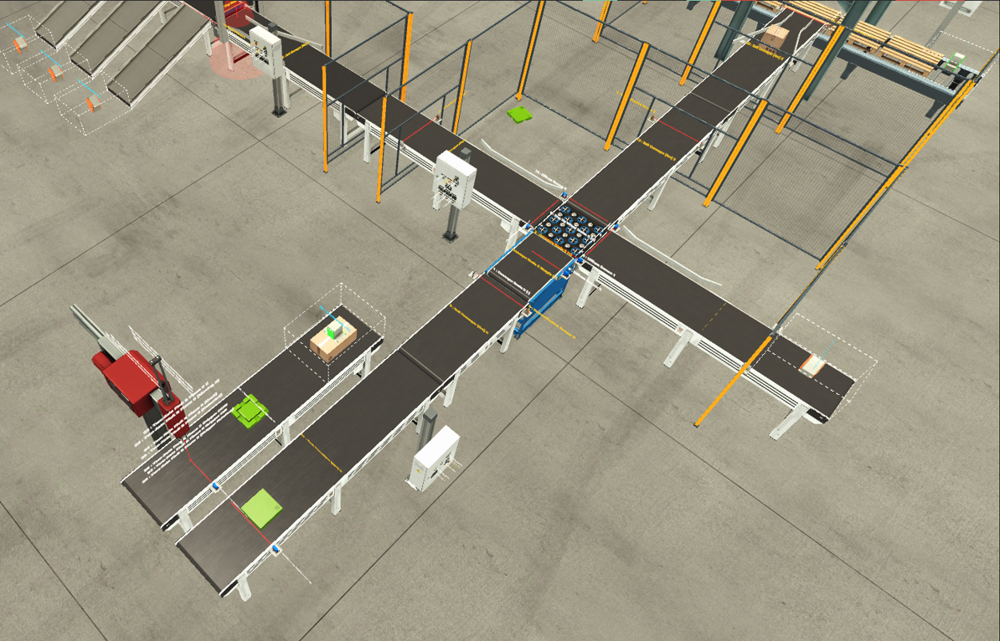

# Sortering på vikt, vision och palletering


**PLC-styrning av en sorteringslinje. Detaljerna vägs, sorteras åt tre håll, färgsorteras med en visionsensor, och de tunga kartongerna läggs på pall.**



---

## I korthet

| | |
|---|---|
| **Vad** | Vägning, vägskäl åt tre håll, visionsortering till tre rännor och palletering med pick & place |
| **Plattform** | Siemens S7-1200 (CPU 1212C) i TIA Portal V21, testat i S7-PLCSIM |
| **Omfattning** | 7 funktionsblock, 87 I/O-taggar, 3 robotar/sorterare, 3 utgångar |
| **Sammanhang** | Övningsprojekt under utbildningen till automationsingenjör (YH) |

**Det här visar projektet:**

- Stegsekvenser i SCL med en CASE per station, där varje steg visar sina utgångar och villkoret för att gå vidare (`// Klart när:`)
- Analog vägning (0–10 V) och beslut utifrån vikten
- Visionsensor som läser detaljens typ och färg medan ett stoppblad håller den stilla
- Analog positionering i tre axlar av en pick & place-robot, med återkoppling från positionsgivarna
- Driftsekvens med återställning, startvarning, kontrollerat stopp och nödstopp
- Vakttimer per sekvens och larm för PALL FULL
- Verifierat med 30 fps-inspelningar av scenen, inte bara med räknarna i PLC:n

---

## Koden

Klicka på ett block för att läsa koden direkt på GitHub.

| Block | Vad det gör |
|---|---|
| [`Drift`](blocks/Drift.s7dcl) | Driftlägen: behöver återställning, redo, startvarning, drift, stoppar, återställer och nödstopp. Styr tornljus och knapplampor |
| [`Overforing`](blocks/Overforing.s7dcl) | Tvåaxlig pick & place flyttar en detalj i taget från matarbandet till bandet mot vågen |
| [`Inmatning_Vag`](blocks/Inmatning_Vag.s7dcl) | Bandvåg och Pop Up Wheel Sorter: väger detaljen och skickar den åt vänster, höger eller rakt fram |
| [`Vanster_Vision`](blocks/Vanster_Vision.s7dcl) | Stoppblad, visionsensor och tre Pivot Arm Sorters till rännorna |
| [`Hoger`](blocks/Hoger.s7dcl) | Banden på vänster och höger linje, räknar lätta kartonger |
| [`Robot_Pall`](blocks/Robot_Pall.s7dcl) | Pallmatning och pick & place som lägger tunga kartonger på pall, larm för PALL FULL |
| [`Sortering_Logg`](blocks/Sortering_Logg.s7dcl) | Felsökning: pulser per givare och de 10 senaste vägningarna och vision-ID:na |
| [`Sort_DB`](blocks/Sort_DB.s7dcl) | Gemensam DB: destination, vikt, räknare, larm och HMI-knappar |
| [`Logik`](blocks/Logik.s7dcl) | Anropar alla block |

Övrigt: [taggtabell (I/O)](tags/IO.csv) · [hårdvarukonfiguration](hardware.md)

---

## Flöde

```
Matarband
   │  Two-Axis Pick & Place (bandet under står still medan detaljen sätts ner)
   ▼
Bandvåg ── vikt < 4,5 V ──► VÄNSTER: stoppblad + Vision Sensor
   │                            ├─ blå lock/bas   → ränna 1
   │                            ├─ grön lock/bas  → ränna 2
   │                            └─ övrigt         → ränna 3
   ├── 4,5–6,5 V ──────────► HÖGER: lätta kartonger (Box M) till removern
   │
   └── vikt > 6,5 V ───────► RAKT FRAM: tunga kartonger (Box L)
                                └─ stannar vid givaren → Pick & Place → pall
                                   full pall ut, ny pall in (annars larm PALL FULL)
```

---

## Stationer

### 1. Överföring
En tvåaxlig robot tar detaljen från matarbandet och sätter ner den på bandet mot vågen. Det bandet står still medan roboten sänker, släpper och lyfter, så att detaljen inte välter. Nästa detalj hämtas först när vågen är ledig.

### 2. Våg och vägskäl
Detaljen körs till mitten av bandvågen och står still i 1,5 s innan vikten läses (27648 = 10 V). Vägskälet skickar den åt rätt håll och väntar tills detaljen syns på utbandet. Bara en detalj åt gången finns mellan vågen och vägskälet.

### 3. Vänster: vision och rännor
Stoppbladet håller detaljen under visionsensorn. När ID:t är läst svänger rätt sorterare ut, bladet släpper och sorteraren håller kvar tills detaljen nått sin ränna. Har inget ID lästs efter 5 s går detaljen till ränna 3 och räknas som felsorterad.

### 4. Rakt fram: palletering
| Steg | Gör | Klart när |
|---|---|---|
| 0 | Hemma | Tom pall på plats |
| 1 | Banden kör fram kartongen | Retroreflective Sensor 5 bruten |
| 2 | Kartongen stannar | 1 s |
| 3 | Över kartongen (X 7,4 V / Y 5,5 V) | Framme |
| 4 | Ner | Box Detected |
| 5–6 | Grip och upp | Uppe |
| 7–8 | Över pallen (X 3,6 V / Y 4,5 V) och ner | Nere |
| 9 | Släpp, räkna kartongen | 0,5 s |
| 10 | Upp och hem | Uppe |

Pallsekvensen går parallellt: ny pall fram, lastas, full pall ut. Kommer ingen pall inom 45 s sätts larmet **PALL FULL**.

---

## Driftlägen och säkerhet

| Steg | Läge | Tornljus |
|---|---|---|
| 0 | Behöver återställning | Röd |
| 5 | Återställer (alla sekvenser till steg 0) | Gul |
| 1 | Redo | Grön |
| 2 | Startvarning 3 s | Gul |
| 3 | Drift | Grön |
| 4 | Stoppar: inga nya detaljer, linjerna körs tomma | Grön + gul |
| 9 | Nödstopp: allt stannar, kräver uppdragning och Återställ | Röd |

Varje sekvens har en vakttimer på 60 s som larmar och går till ett säkert läge om ett steg hänger sig.

---

## Problem som löstes

- **Detaljen sorterades fel på vänster linje.** Visionsensorn sitter vid stoppbladet och inte före det, så en kö med ID:n blev fel. Löst genom att läsa ID:t medan bladet håller detaljen.
- **Kartongen ramlade av bandet vid pallen.** Löst genom att stoppa banden så fort kartongen bryter Retroreflective Sensor 5, och sedan plocka den där.
- **Robotens upplock var osäkert** och letade på flera ställen. Löst med fast plockposition när kartongen redan står stilla vid givaren.
- **Detaljer välte vid överföringen.** Löst genom att stoppa bandet medan roboten sätter ner detaljen.

---

## Vidareutveckling

- HMI på en MTP1200 med processbild, räknare och larm
- Flera kartonger per pall med ett lastmönster
- Larmhistorik med tidsstämpel

---

## Verktyg

- Factory IO 2.5.10 (Siemens Edition)
- TIA Portal V21, SCL
- S7-1200 i S7-PLCSIM

---

## Om mig

Jag studerar till automationsingenjör på Teknikhögskolan Linköping (YH, 2025–2027) och har fem års erfarenhet som operatör i livsmedelsindustrin. Jag söker LIA, deltid eller anställning inom automation. Kontakta mig gärna via LinkedIn.

> Endast testat i simulering. Eventuella `Test_*`-block som skriver till ingångar ska tas bort före nedladdning till en riktig PLC.
